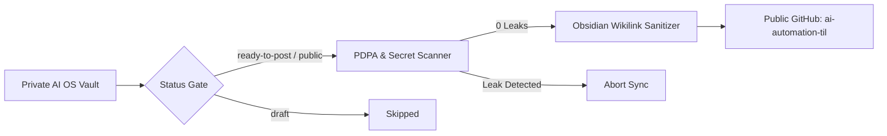

---
title: "TIL — Today I Learned (Apec Sinlapachai)"
last_updated: 2026-11-21
domain: learning/til
status: public
tags: [til, learn-in-public, ai-systems, automation, portfolio]
---

# 🚀 Today I Learned (TIL) — AI Systems & Automation Engineering Notes

Public engineering log and architecture notes by **Sinlapachai Kaeobunrueang (Apec)** — *AI & Automation Specialist | GTM Engineer*.  
Covering production workflow automation, context engineering, agentic pipelines, security hardening, and developer operations.

> **Related Repositories & Connect:**
> - **GitHub Profile:** [github.com/ApecSinlapachai](https://github.com/ApecSinlapachai)
> - **LinkedIn:** [linkedin.com/in/apec-sinlapachai](https://www.linkedin.com/in/apec-sinlapachai)
> - **Production Build:** [fast-lead-automation](https://github.com/ApecSinlapachai/fast-lead-automation) *(Google Apps Script, LINE Flex API, Multi-Platform n8n v2.0 — 85/85 Automated Tests)*
> - **Media Automation:** [agentic-media-pipeline](https://github.com/ApecSinlapachai/agentic-media-pipeline) *(Zero-dep Python + FFmpeg Audio/Video Automation)*
> - **YouTube:** [Apec Sinlapachai](https://youtu.be/V7EboxNpv0Y)

---

## 🛡️ Automated Publishing Pipeline

This repository is automatically sanitized and synced from my private Personal AI OS using a deterministic PowerShell export pipeline (`sync_til_public.ps1`):

> *Note: Entries from `TIL #018` onward are authored English-first for global technical readers. Earlier foundational notes (`#001–#017`) include original Thai build logs with English titles and architecture summaries.*

---

## 🗂️ Categories (TIL #001–#023)

### 🤖 1. AI Systems & Context Engineering (`ai-systems/`)
- **TIL #001:** [Designing a 2-Tier Summary Bridge for Personal AI OS](./ai-systems/2026-11-14_2-tier-summary-bridge-ai-os.md) — Solving context bloat and cross-project silos
- **TIL #002:** [Model Routing & Quota Optimization (Gemini 4 Argon vs. Hydrogen)](./ai-systems/2026-11-14_antigravity-argon-vs-hydrogen-model-routing.md)
- **TIL #011:** [Human-Only Zone, Triage & Priority Gatekeeper Guardrails in AI OS](./ai-systems/2026-11-16_ai-os-human-zone-triage-and-priority-gatekeeper.md)
- **TIL #017:** [Fine-Tuning vs. RAG vs. Context Engineering — Architecture & Discovery Playbook](./ai-systems/2026-11-18_fine-tuning-vs-rag-vs-context-engineering-ai-os.md)
- **TIL #018:** [Deterministic QA Gates, PDPA Guardrails, SSOT Deduplication & Obsidian Bases](./ai-systems/2026-11-19_ai-os-deterministic-qa-pdpa-guard-and-obsidian-bases.md) *(EN)*

### ⚙️ 2. Automation & GTM Engineering (`automation-agency/`)
- **TIL #003:** [Fast-Lead Automation Dual-Mode Architecture (Mini-CRM + Apps Script + n8n + LINE Flex)](./automation-agency/2026-11-14_fast-lead-automation-crm-apps-script-n8n.md)
- **TIL #004:** [Deterministic HTML/CSS + Chrome Headless Asset Generator with Safe-Zone Checks](./automation-agency/2026-11-14_html-css-mobile-first-gig-cover-generator.md)
- **TIL #007:** [E2E Fast-Lead Testing (7 Cases) — Fixing Sheets Leading-Zero Stripping & Fuzzy Form Parsing](./automation-agency/2026-11-15_e2e-fast-lead-testing-apps-script-line-flex.md)
- **TIL #009:** [Reusable Asset Generation Skill & Multi-Viewport QA Pipeline](./automation-agency/2026-11-15_ab-cover-v2-and-reusable-cover-design-skill.md)
- **TIL #010:** [Productized Service Launch & Responsive Safe-Zone Alignment](./automation-agency/2026-11-16_fastwork-gig01-live-16x9-cover-copywriting-skill.md)
- **TIL #013:** [Zero-Overhead Auto-Reply Email (< 1 min) via Google Apps Script Properties](./automation-agency/2026-11-17_gig01-100pct-byob-and-apps-script-auto-reply.md)
- **TIL #015:** [Production-Hardening Apps Script (`LockService`, Formula-Injection Guard, Regex Parsing & LINE Flex Audit)](./automation-agency/2026-11-18_apps-script-fast-lead-v2-v3-security-and-flex-audit.md)
- **TIL #021:** [Competitive Benchmarking in AI Automation — Fastwork Top 1% Audit, Gig #2 Launch & Global Track B Content Strategy](./automation-agency/2026-11-20_fastwork-top1-audit-gig02-launch-and-global-track-b-content.md) *(EN)*
- **TIL #022:** [Building & Testing Fast-Lead v2.0 Multi-Platform Router via n8n Workflow SDK & Live MCP](./automation-agency/2026-11-21_fast-lead-v2-multi-platform-n8n-mcp-and-sdk-testing.md) *(EN)*

### 🛠️ 3. Workflows, Media & Engineering Ops (`workflows-ops/`)
- **TIL #005:** [Syncthing Mobile Quick-Capture Inbox without Git Merge Conflicts](./workflows-ops/2026-11-14_syncthing-mobile-quick-capture-git-hygiene.md)
- **TIL #006:** [Refactoring Large Specs into Modular Folders & Workspace Hygiene](./workflows-ops/2026-11-14_modular-gig-folder-and-agent-workspace-hygiene.md)
- **TIL #008:** [Public TIL GitHub Export Pipeline with Automated Secret & PDPA Guard](./workflows-ops/2026-11-15_public-til-github-sync-pipeline-with-secret-guard.md)
- **TIL #014:** [1920×1080 HTML Slide Decks & FFmpeg 9.0.2 Auto-Cut Pipeline (`-16 LUFS`)](./workflows-ops/2026-11-17_ep01-html-slides-and-ffmpeg9-auto-cut-pipeline.md)
- **TIL #016:** [3-Stage Media Production Workspace (`01-raw` → `02-autocut` → `03-ready`) & Channel Launch](./workflows-ops/2026-11-18_youtube-channel-branding-3-stage-media-and-ep01-launch.md)
- **TIL #019:** [GitHub Portfolio Overhaul — Archiving 30 Legacy Repos, Shipping 4 Flagship Repos & a 4-Role ATS Resume](./workflows-ops/2026-11-19_github-portfolio-overhaul-4-flagship-repos-and-ats-resume.md) *(EN)*
- **TIL #020:** [Building a Repeatable Job Search Engine — Daily Job Radar, Tailored ATS Resumes & GitHub Portfolio Sync Skill](./workflows-ops/2026-11-20_automated-job-radar-tailored-ats-resumes-and-github-sync-skill.md) *(EN)*
- **TIL #023:** [YouTube Repurpose Pipeline MVP, Client Project Bridge & 3-Track NOC STEM Roadmap](./workflows-ops/2026-11-21_yt-repurpose-pipeline-client-bridge-and-noc-stem-roadmap.md) *(EN)*

### 📖 4. Applied Strategy & Book Notes (`books/`)
- **TIL #012:** [Applying Value Ladder & Habit Stacking to Technical Goal Execution](./books/2026-11-16_think-and-grow-rich-ch01-value-ladder-and-habit-stacking.md)
- [Book Notes Index](./books/README.md)

